# Publicação automática (CI/CD)

Como o site chega à homologação e à produção pelo GitHub Actions. O caminho manual (`bin\migrar.ps1`, em `lancamento.md`) continua valendo para ensaios e emergências; este aqui é o caminho do dia a dia.

## O fluxo

```mermaid
flowchart LR
  PR[Pull request] -->|revisão + Testes verdes| M[main]
  M -->|workflow Testes passa| H[Homologação<br/>automática]
  H -->|guarda o pacote .tgz<br/>e grava ieadc_deploy| HML[(Site de homologação)]
  HML -.->|trava: mesmo commit,<br/>mesmo pacote| P[Produção<br/>você dispara]
  P -->|release + pacote anexado| R[GitHub Release]
  R -->|aprovação no environment producao| PROD[(ieadcvilaipiranga.com.br)]
```



- **Homologação** (`.github/workflows/homologacao.yml`): sozinha. Quando um commit entra na `main` e o workflow **Testes** passa, sobe o site, monta o pacote, guarda como artifact (30 dias), envia à homologação e roda os testes de fumaça.
- **Produção** (`.github/workflows/producao.yml`): **só quando você dispara**. Passa pela trava, cria a release com o mesmo pacote da homologação, espera a sua aprovação e implanta.
- Os scripts são `bin/implantar.sh` (empacotar, enviar, fumaça, ler o que está rodando), `bin/migrar-remoto.sh` (carga completa, roda no servidor) e `bin/atualizar-remoto.sh` (só código, roda no servidor).

## O que a trava garante (regra de ouro: a produção fica sempre atrás da homologação)

O job `trava-hml` falha, e nada é criado nem enviado, se qualquer item abaixo não for verdade:

1. Você digitou a confirmação certa (`PRODUCAO` no modo `codigo`; `CARGA-INICIAL` no modo `completo`) e a versão tem o formato `vX.Y.Z` e ainda não existe.
2. O workflow rodou na `main` e o commit é a **ponta da main** agora.
3. O workflow **Testes** passou nesse commit.
4. A homologação está rodando **exatamente esse commit** (lido por SSH da opção `ieadc_deploy` do site de homologação).
5. Existe o artifact do pacote **da execução que a homologação recebeu** e ele não expirou.

Depois disso: o pacote é baixado e conferido pelo SHA-256 gravado na homologação, anexado à release e a produção recebe esse arquivo (baixado da release, conferido de novo). Nada é refeito entre a homologação e a produção: o que foi validado é o que vai ao ar. Além disso, o `bin/implantar.sh` recusa a produção sem a confirmação certa e recusa um pacote feito de outro commit.

Os segredos da produção (`PROD_*`) existem **só** no environment `producao` e só o workflow Produção os usa. A homologação nunca tem acesso a eles.

## Preparação (uma vez)

### 1. As hospedagens

Em cada uma (homologação e produção): WordPress instalado pelo hPanel, em português, com prefixo de tabelas `wp_`, e SSH habilitado (hPanel > Avançado > SSH). É o mesmo pré-requisito do `lancamento.md`.

### 2. Uma chave SSH para cada ambiente

No Git Bash (no PowerShell 5 o argumento vazio some; use o Git Bash ou `cmd /c`):

```
ssh-keygen -t ed25519 -N "" -f chave-hml -C github-actions-hml
ssh-keygen -t ed25519 -N "" -f chave-prod -C github-actions-prod
```

- A chave **pública** (`chave-hml.pub`) vai para o hPanel > Avançado > SSH (chaves SSH autorizadas) da hospedagem correspondente.
- A chave **privada** (`chave-hml`, o arquivo inteiro, com as linhas `BEGIN` e `END`) vai para o segredo `HML_SSH_CHAVE`. Depois apague os arquivos do computador. Nunca coloque a chave no repositório.

### 3. A impressão digital do servidor

O workflow só conecta se a chave do servidor tiver a impressão digital que você cadastrou (sem ela a conexão é recusada, nunca "aceita qualquer um"). Para descobrir, de uma rede em que você confia (no Git Bash; o `>` do PowerShell 5 grava em outra codificação):

```
ssh-keyscan -t ed25519 -p <porta> <servidor> > chave-do-servidor.txt
ssh-keygen -lf chave-do-servidor.txt
```

A linha que começa com `256 SHA256:...` traz o valor (`SHA256:...`). Confira com a que aparece na primeira vez que você entra por SSH pelo seu terminal. Se a hospedagem trocar de servidor, o workflow vai falhar com "a impressão digital NÃO bate": atualize o segredo depois de conferir.

### 4. Environments e segredos

No GitHub: Settings > Environments > New environment, com os nomes `homologacao` e `producao`. Tudo é cadastrado como **segredo do environment** (e não como variável) porque o repositório é público e o log das execuções também: o GitHub esconde o valor dos segredos nos logs.

| Environment | Segredo | O que é |
|---|---|---|
| `homologacao` | `HML_SSH_CHAVE` | chave privada SSH da homologação |
| | `HML_SERVIDOR` | servidor SSH (hPanel > Avançado > SSH) |
| | `HML_PORTA` | porta SSH |
| | `HML_USUARIO` | usuário SSH |
| | `HML_URL` | endereço do site de homologação (`https://...`) |
| | `HML_IMPRESSAO` | impressão digital do servidor (`SHA256:...`) |
| | `HML_DESTINO` (opcional) | pasta do site, se não for `domains/<endereço>/public_html` |
| | `HML_EMAIL_ADMIN` (opcional) | e-mail do administrador do site |
| `producao` | `PROD_SSH_CHAVE` | chave privada SSH da produção |
| | `PROD_SERVIDOR` | servidor SSH |
| | `PROD_PORTA` | porta SSH |
| | `PROD_USUARIO` | usuário SSH |
| | `PROD_IMPRESSAO` | impressão digital do servidor (`SHA256:...`) |
| | `PROD_URL` (opcional) | só se não for `https://ieadcvilaipiranga.com.br` |
| | `PROD_DESTINO` (opcional) | pasta do site, se não for `domains/ieadcvilaipiranga.com.br/public_html` |
| | `PROD_EMAIL_ADMIN` (opcional) | e-mail do administrador do site |

Variável (não é segredo) opcional no environment `homologacao`: `HML_MODO` = `homologacao` (padrão: aberta para quem tem o link e fora do Google) ou `homologacao-fechada` (só quem tem login).

Não cadastre nenhum `PROD_*` como segredo do repositório nem no environment `homologacao`.

### 5. Proteções (Settings do repositório)

- **Environment `producao`**: marque **Required reviewers** (você e, se houver, uma segunda pessoa; com duas pessoas, marque também *Prevent self-review*) e em **Deployment branches and tags** deixe só `main`. É isso que impede que alguém dispare o workflow de outra branch (com um script alterado) para chegar às credenciais da produção.
- **Environment `homologacao`**: sem revisores (a implantação é automática); deployment branches só `main`.
- **Branch `main`** (Settings > Rules > Rulesets): exigir pull request, exigir o status check `testes` (o job do workflow Testes), bloquear force push e exclusão. Sem isso, qualquer commit direto na `main` seguiria para a homologação.
- Settings > Actions > General: *Fork pull request workflows* exigindo aprovação, e *Workflow permissions* só leitura (cada workflow pede o que precisa).

## Rotina

### Homologação

Nada a fazer: mesclou na `main` com os testes verdes, a homologação é atualizada em alguns minutos (Actions > Homologação). A cada implantação ela **recebe o conteúdo do seed** (carga completa): o que for editado no painel da homologação se perde. Se precisar reimplantar o mesmo commit: Actions > Homologação > Run workflow (na `main`).

### Lançar uma release na produção

1. Confirme que a homologação está no commit que você quer lançar (Actions > Homologação verde) e que a equipe validou o site de homologação.
2. Actions > **Produção** > Run workflow, na branch `main`:
   - `versao`: `vX.Y.Z` (use sempre uma nova; ex.: `v1.0.0`).
   - `modo`:
     - `codigo`: só tema e mu-plugins. **Não mexe em conteúdo, usuários, fotos nem no estado do site (aberto/fechado).** É o modo de sempre depois que a produção tem conteúdo editado no painel. Confirmação: `PRODUCAO`.
     - `completo`: código + banco + fotos (substitui o conteúdo da produção; cópia do banco anterior fica no servidor). Só para a **carga inicial**. Confirmação: `CARGA-INICIAL`.
   - `abertura` (só vale no `completo`): `fechado` (ensaio: visitantes veem "em preparação", fora do Google) ou `no-ar` (lança e libera para o Google).
   - `confirmacao`: o texto da confirmação, como acima.
3. Aprove o deployment no environment `producao` (você recebe o aviso do GitHub).
4. Ao final: a release `vX.Y.Z` fica publicada com o pacote anexado, os testes de fumaça passaram e o site registra o que está rodando.

Sequência da primeira vez: `completo` + `fechado` (ensaio) para conferir entrando em `/wp-login.php`; quando liberarem, `completo` + `no-ar` (enquanto ninguém editou nada na produção) ou abra pelo terminal SSH da hospedagem: `wp option update ieadc_site_fechado 0` e `wp option update blog_public 1`. Depois disso, só `codigo`.

O modo `codigo` não cria páginas nem muda o banco. Mudança que precisa de conteúdo novo (página, menu, configuração) é feita pelo painel da produção.

### Ver o que está rodando

Em qualquer ambiente, pelo SSH: `wp option get ieadc_deploy` devolve, por exemplo, `{"sha":"...","ambiente":"producao","versao":"v1.0.0","quando":"...","run_id":"...","carga":"codigo","pacote":"<sha256>"}`.

### Os testes de fumaça

No fim de toda implantação (homologação e produção): página inicial, `/sobre-nos/`, `/eventos/` e `/wp-login.php` respondem 200 (com o site fechado, as três páginas respondem 503 e o login 200), o sitemap (`/sitemap_index.xml` ou `/wp-sitemap.xml`) responde 200 com o site aberto, e as opções `ieadc_site_fechado` e `blog_public` batem com o modo escolhido. Se algo falhar, o workflow fica vermelho.

## Voltar atrás

- **Só código** (modo `codigo`): o servidor guarda as 5 últimas cópias em `~/backup-codigo-antes-*.tgz`. Pelo SSH: `tar -xzf ~/backup-codigo-antes-<data>.tgz -C ~/domains/<site>/public_html/wp-content` e depois `wp --path=~/domains/<site>/public_html cache flush`. O jeito normal, porém, é reverter o commit por pull request: a `main` muda, a homologação recebe e você lança uma versão nova.
- **Carga completa**: o banco anterior fica em `~/backup-antes-da-migracao-*.sql`. Pelo SSH: `wp --path=~/domains/<site>/public_html db import ~/backup-antes-da-migracao-<data>.sql`. Isso desfaz também o que a equipe editou depois da carga.
- **Aprovação recusada ou falha no meio**: a release fica marcada como *pré-lançamento* (sinal de que não foi implantada). Apague a release e a tag dela antes de reutilizar o número, ou use a próxima versão.
- Nunca reaproveite uma tag para outro commit.

## Limites e cuidados

- Os artifacts expiram em 30 dias: se a homologação ficou mais que isso sem receber um commit, a trava avisa; rode Homologação de novo antes de lançar.
- O job `trava-hml` usa o environment `homologacao` só para ler o `ieadc_deploy` por SSH; por isso aparece nos "Deployments" da homologação. Não é uma implantação.
- Se uma hospedagem bloquear os endereços do GitHub (firewall), o envio ou a fumaça vão falhar com a mensagem do problema; nesse caso use o caminho manual do `lancamento.md`.
- Sem acesso ao wordpress.org o servidor não instala os plugins (a fumaça acusa se o sitemap sumir).
- Teste sem tocar em servidor real: o mesmo `bin/implantar.sh` roda contra a "hospedagem de mentira" de `tests/migracao` (veja o final de `lancamento.md`); passe `ALVO_*`, `ALVO_IMPRESSAO` com a impressão do servidor de mentira e `ALVO_DESTINO=domains/ieadcvilaipiranga.com.br/public_html`.
