# Publicação automática (CI/CD)

Como o site chega à homologação e à produção pelo GitHub Actions.

> **Atenção: o caminho manual (`bin\migrar.ps1`, em `lancamento.md`) NÃO passa pela trava.** Ele envia o que está no seu computador, sem conferir testes, commit, homologação nem release. Use-o só para ensaios e emergências, sabendo disso. Este documento descreve o caminho do dia a dia.

## O fluxo

```mermaid
flowchart LR
  PR[Pull request] -->|revisão + Testes verdes| M[main]
  M -->|workflow Testes passa| H[Homologação<br/>automática]
  H -->|fumaça passou: guarda o pacote<br/>e grava ieadc_deploy| HML[(Site de homologação)]
  HML -.->|trava: mesmo commit,<br/>execução com sucesso,<br/>mesmo pacote| P[Produção<br/>você dispara]
  P -->|release + pacote anexado| R[GitHub Release]
  R -->|aprovação no environment producao| PROD[(ieadcvilaipiranga.com.br)]
```



- **Homologação** (`.github/workflows/homologacao.yml`): sozinha. Quando um commit entra na `main` e o workflow **Testes** passa, sobe o site do zero, monta o pacote, envia à homologação, roda os testes de fumaça e só então guarda o pacote como artifact (30 dias) e grava `ieadc_deploy` com resultado `ok`.
- **Produção** (`.github/workflows/producao.yml`): **só quando você dispara**. Passa pela trava, cria a release com o mesmo pacote da homologação, espera a sua aprovação e implanta.
- Scripts: `bin/implantar.sh` (empacotar, enviar, fumaça, ler o que está rodando), `bin/trava-producao.sh` (a trava), `bin/migrar-remoto.sh` (carga completa, roda no servidor) e `bin/atualizar-remoto.sh` (só código, roda no servidor).

## O que a trava garante (regra de ouro: a produção fica sempre atrás da homologação)

O job `trava-hml` falha, e nada é criado nem enviado, se qualquer item abaixo não for verdade:

1. Confirmação certa (`PRODUCAO` no modo `codigo`; `CARGA-INICIAL` ou `SUBSTITUIR-CONTEUDO` no `completo`) e versão no formato `vX.Y.Z` que ainda não existe.
2. O workflow rodou na `main` e o commit é a **ponta da main** (conferido de novo depois da sua aprovação, antes de enviar).
3. O workflow **Testes** passou nesse commit.
4. A homologação está rodando **exatamente esse commit** e a última implantação dela terminou **bem** (lido por SSH da opção `ieadc_deploy`; ela só diz `ok` depois que os testes de fumaça passam, e fica `falhou` se eles falharem).
5. A execução do GitHub registrada nessa opção existe, está **concluída com sucesso**, é do **mesmo commit** e é do workflow **Homologação**.
6. O artifact do pacote **dessa execução** existe e não expirou.

Depois disso o pacote é baixado e conferido pelo SHA-256 gravado na homologação, anexado à release, e a produção recebe esse arquivo (baixado da release, conferido de novo). Nada é refeito entre a homologação e a produção: o que foi validado é o que vai ao ar.

Travas no próprio `bin/implantar.sh` (valem para qualquer uso do script):

- A **homologação nunca aceita o domínio da produção** (nem `www.`), e a **produção só aceita o domínio da produção**.
- A pasta no servidor é **exatamente** `domains/<domínio do site>/public_html` (a da produção é sempre `domains/ieadcvilaipiranga.com.br/public_html`): sem `..`, sem `/` no início, sem `//`, sem espaços. Qualquer outra pasta, inclusive as de outros sites que existem na mesma conta de hospedagem, é recusada antes de qualquer conexão. O `bin/atualizar-remoto.sh` repete a conferência no servidor.
- Ambiente e modo precisam combinar: homologação só com `homologacao` ou `homologacao-fechada`; produção só com `ensaio` ou `lancar`. Por isso `HML_MODO=lancar` é recusado.
- A carga `completo` na produção que **já recebeu uma carga** (opção `ieadc_deploy` ou `ieadc_site_fechado` no site) só passa com a confirmação `SUBSTITUIR-CONTEUDO`, para não apagar o que a equipe editou no painel.

### Conta SSH compartilhada: o que isso muda

A homologação e a produção ficam **na mesma conta de hospedagem, com o mesmo usuário SSH**. Portanto, no nível da hospedagem, a chave da homologação alcança a pasta da produção (e as pastas de outros sites da conta). Os segredos do GitHub continuam separados (só o environment `producao` enxerga os `PROD_*`), mas **a chave SSH da homologação não é uma barreira de segurança para a produção**. O que protege a produção é: a trava de domínio e de pasta do `bin/implantar.sh`, o revisor obrigatório no environment `producao`, a restrição à `main`, as regras da `main` e o `CODEOWNERS` (quem muda `.github/` e `bin/` precisa da sua aprovação). Se a hospedagem permitir contas SSH separadas para cada site, prefira isso.

## Preparação (uma vez)

### 1. As hospedagens

Em cada uma (homologação e produção): WordPress instalado pelo hPanel, em português, com prefixo de tabelas `wp_`, e SSH habilitado (hPanel > Avançado > SSH). É o mesmo pré-requisito do `lancamento.md`.

### 2. Uma chave SSH para cada ambiente

No Git Bash (no PowerShell 5 o argumento vazio some; use o Git Bash ou `cmd /c`):

```
ssh-keygen -t ed25519 -N "" -f chave-hml -C github-actions-hml
ssh-keygen -t ed25519 -N "" -f chave-prod -C github-actions-prod
```

- A chave **pública** (`chave-hml.pub`) vai para o hPanel > Avançado > SSH (chaves SSH autorizadas).
- A chave **privada** (`chave-hml`, o arquivo inteiro, com as linhas `BEGIN` e `END`) vai para o segredo `HML_SSH_CHAVE`. Depois apague os arquivos do computador. Nunca coloque a chave no repositório.

### 3. A impressão digital do servidor

O workflow só conecta se a chave do servidor tiver a impressão digital que você cadastrou (sem ela a conexão é recusada, nunca "aceita qualquer um"). Para descobrir, de uma rede em que você confia (no Git Bash; o `>` do PowerShell 5 grava em outra codificação):

```
ssh-keyscan -t ed25519 -p <porta> <servidor> > chave-do-servidor.txt
ssh-keygen -lf chave-do-servidor.txt
```

A linha que começa com `256 SHA256:...` traz o valor (`SHA256:...`). Confira com a que aparece na primeira vez que você entra por SSH pelo seu terminal. Se a hospedagem trocar de servidor, o workflow vai falhar com "a impressão digital do servidor NÃO bate": atualize o segredo depois de conferir.

### 4. Environments e segredos

No GitHub: Settings > Environments > New environment, com os nomes `homologacao` e `producao`. Tudo é cadastrado como **segredo do environment** (e não como variável) porque o repositório é público e o log das execuções também: o GitHub esconde o valor dos segredos nos logs.

| Environment | Segredo | O que é |
|---|---|---|
| `homologacao` | `HML_SSH_CHAVE` | chave privada SSH da homologação |
| | `HML_SERVIDOR` | servidor SSH (hPanel > Avançado > SSH) |
| | `HML_PORTA` | porta SSH |
| | `HML_USUARIO` | usuário SSH |
| | `HML_URL` | endereço do site de homologação (`https://...`; nunca o domínio da produção) |
| | `HML_IMPRESSAO` | impressão digital do servidor (`SHA256:...`) |
| | `HML_DESTINO` (opcional) | só é aceito se for exatamente `domains/<endereço da homologação>/public_html` (o padrão); outra pasta é recusada |
| | `HML_EMAIL_ADMIN` (opcional) | e-mail do administrador do site |
| `producao` | `PROD_SSH_CHAVE` | chave privada SSH da produção |
| | `PROD_SERVIDOR` | servidor SSH |
| | `PROD_PORTA` | porta SSH |
| | `PROD_USUARIO` | usuário SSH |
| | `PROD_IMPRESSAO` | impressão digital do servidor (`SHA256:...`) |
| | `PROD_URL` (opcional) | só se aceita o domínio principal (`https://ieadcvilaipiranga.com.br` ou com `www.`) |
| | `PROD_DESTINO` (opcional) | só é aceito se for exatamente `domains/ieadcvilaipiranga.com.br/public_html` |
| | `PROD_EMAIL_ADMIN` (opcional) | e-mail do administrador do site |

Variável (não é segredo) opcional no environment `homologacao`: `HML_MODO` = `homologacao` (padrão: aberta para quem tem o link e fora do Google) ou `homologacao-fechada` (só quem tem login). Qualquer outro valor (como `lancar`) é recusado.

Não cadastre nenhum `PROD_*` como segredo do repositório nem no environment `homologacao`.

### 5. Proteções (Settings do repositório)

- **Environment `producao`**: marque **Required reviewers** (você e, se houver, uma segunda pessoa; com duas pessoas, marque também *Prevent self-review*) e em **Deployment branches and tags** deixe só `main`. Isso impede que alguém dispare o workflow de outra branch (com um script alterado) para chegar às credenciais da produção.
- **Environment `homologacao`**: sem revisores (a implantação é automática); deployment branches só `main`.
- **Branch `main`** (Settings > Rules > Rulesets): exigir pull request, exigir o status check `testes` (o job do workflow Testes), **exigir revisão dos Code Owners** (o arquivo `.github/CODEOWNERS` põe você como dono de `.github/` e `bin/`), bloquear force push e exclusão. Sem isso, qualquer commit direto na `main` seguiria para a homologação.
- Settings > Actions > General: *Fork pull request workflows* exigindo aprovação, e *Workflow permissions* só leitura (cada workflow pede o que precisa).

### Checklist antes da primeira release

- [ ] Environments `homologacao` e `producao` criados, com todos os segredos obrigatórios da tabela.
- [ ] `producao` com **revisor obrigatório** e **só a branch `main`** nas regras de implantação.
- [ ] Ruleset da `main` ativo (pull request, check `testes`, Code Owners, sem force push).
- [ ] WordPress de fábrica instalado nas duas hospedagens, SSH habilitado e chave pública autorizada.
- [ ] Impressões digitais conferidas por você (não copiadas de um log).
- [ ] A homologação **já recebeu pelo menos uma implantação** deste pipeline com sucesso (Actions > Homologação verde) e a equipe validou o site. Sem isso a trava não deixa lançar.
- [ ] Você sabe que o caminho manual (`migrar.ps1`) não passa pela trava.

## Glossário

- **Artifact**: arquivo guardado por uma execução do GitHub Actions (aqui, o pacote `.tgz` da homologação, por 30 dias).
- **Environment**: ambiente do GitHub (`homologacao`, `producao`) com seus próprios segredos e regras (revisores, branches permitidas).
- **Ruleset**: conjunto de regras do repositório (por exemplo, o que é exigido para entrar na `main`).
- **Check**: verificação automática que aparece no pull request (por exemplo, o job `testes`).
- **Fumaça**: teste rápido por HTTP logo depois de implantar (as páginas principais respondem como deveriam).
- **Pré-lançamento (pre-release)**: release marcada como "ainda não publicada"; a nossa nasce assim e só vira release comum depois da implantação na produção.

## Rotina

### Homologação

Nada a fazer: mesclou na `main` com os testes verdes, a homologação é atualizada em alguns minutos (Actions > Homologação). A cada implantação ela **recebe o conteúdo do seed** (carga completa): o que for editado no painel da homologação se perde. Esse pacote é montado do zero no runner (`cp .env.example .env`, `bin/setup.sh`, seed): sem dado pessoal; não leva os usuários locais (`wp_users` e `wp_usermeta` ficam de fora). Conferido com `grep` no `banco.sql` de um pacote montado assim: os únicos e-mails são os públicos da igreja (os do protótipo e o do `.env.example`) e o padrão do WordPress (`login@example.com`). Para reimplantar o mesmo commit: Actions > Homologação > Run workflow (na `main`).

### Lançar uma release na produção

1. Confirme que a homologação está no commit que você quer lançar (Actions > Homologação verde) e que a equipe validou o site de homologação.
2. Actions > **Produção** > Run workflow, na branch `main`:
   - `versao`: `vX.Y.Z` (use sempre uma nova; ex.: `v1.0.0`).
   - `modo`:
     - `codigo`: só tema e mu-plugins. **Não mexe em conteúdo, usuários, fotos nem no estado do site (aberto/fechado).** É o modo de sempre depois que a produção tem conteúdo editado no painel. Confirmação: `PRODUCAO`.
     - `completo`: código + banco + fotos (substitui o conteúdo da produção; cópia do banco anterior fica no servidor). Só para a **carga inicial**. Confirmação: `CARGA-INICIAL`. Se a produção já recebeu uma carga antes, o script recusa, a menos que a confirmação seja `SUBSTITUIR-CONTEUDO` (isso apaga o que a equipe editou).
   - `abertura` (só vale no `completo`): `fechado` (ensaio: visitantes veem "em preparação", fora do Google) ou `no-ar` (lança e libera para o Google).
   - `confirmacao`: o texto da confirmação, como acima.
3. Aprove o deployment no environment `producao` (você recebe o aviso do GitHub).
4. Ao final: a release `vX.Y.Z` fica publicada com o pacote anexado, os testes de fumaça passaram e o site registra o que está rodando.

Sequência da primeira vez: `completo` + `fechado` (ensaio) para conferir entrando em `/wp-login.php`; quando liberarem, abra pelo terminal SSH da hospedagem: `wp option update ieadc_site_fechado 0` e `wp option update blog_public 1` (ou, se ninguém editou nada na produção, `completo` + `no-ar` com `SUBSTITUIR-CONTEUDO`). Depois disso, só `codigo`.

O modo `codigo` não cria páginas nem muda o banco. Mudança que precisa de conteúdo novo (página, menu, configuração) é feita pelo painel da produção.

### Ver o que está rodando

Em qualquer ambiente, pelo SSH: `wp option get ieadc_deploy` devolve, por exemplo, `{"sha":"...","ambiente":"producao","versao":"v1.0.0","quando":"...","run_id":"...","carga":"codigo","pacote":"<sha256>","resultado":"ok"}`.

### Os testes de fumaça

No fim de toda implantação (homologação e produção): página inicial, `/sobre-nos/`, `/eventos/` e `/wp-login.php` respondem 200 (com o site fechado, as três páginas respondem 503 e o login 200), o sitemap (`/sitemap_index.xml` ou `/wp-sitemap.xml`) responde 200 com o site aberto, e as opções `ieadc_site_fechado` e `blog_public` batem com o modo escolhido. Se algo falhar, o workflow fica vermelho e a opção `ieadc_deploy` fica com `"resultado":"falhou"`: a trava da produção recusa esse commit até uma nova implantação passar.

## Mensagens da trava e o que fazer

| Mensagem (resumo) | O que fazer |
|---|---|
| "A versão deve ter o formato vX.Y.Z" | Use algo como `v1.0.0`. |
| "Confirmação errada" | Digite `PRODUCAO` (modo `codigo`) ou `CARGA-INICIAL` / `SUBSTITUIR-CONTEUDO` (modo `completo`). |
| "A produção só recebe a main" | Dispare o workflow escolhendo a branch `main`. |
| "A main já avançou" | Entrou outro commit. Espere a Homologação terminar nele e dispare de novo. |
| "O workflow Testes não passou no commit" | Corrija os testes; só commit com Testes verdes é lançado. |
| "A tag vX.Y.Z já existe" | Use a próxima versão (ou apague a release e a tag de uma tentativa recusada). |
| "Não consegui ler a opção ieadc_deploy da homologação por SSH" | A homologação nunca recebeu uma implantação deste pipeline, ou a chave, a porta, o usuário ou a impressão digital (`HML_*`) estão errados. Rode o workflow Homologação e leia o erro. |
| "A última implantação na homologação não terminou bem" | A fumaça falhou na homologação. Corrija e deixe a Homologação passar de novo. |
| "A homologação está no commit X, não em Y" | A homologação ainda não recebeu este commit (ou recebeu outro). Espere o workflow Homologação. |
| "A execução N da Homologação não terminou com sucesso / é de outro commit / não é do workflow Homologação" | Rode a Homologação de novo neste commit. |
| "Não há artifact pacote-hml-... válido" | O pacote expirou (30 dias) ou não foi guardado. Rode a Homologação de novo. |
| "a impressão digital do servidor NÃO bate" | O servidor mudou de chave ou o segredo `*_IMPRESSAO` está errado. Confira como no passo 3 e atualize o segredo. |
| "a homologação não pode apontar para o domínio da produção" | `HML_URL` está com o endereço da produção. Corrija o segredo. |
| "a pasta do site deve ser exatamente ..." | `HML_DESTINO`/`PROD_DESTINO` aponta para outra pasta. Apague o segredo (vale o padrão) ou use a pasta padrão. |
| "o modo X não combina com o ambiente Y" | Homologação só com `homologacao` ou `homologacao-fechada` (`HML_MODO`); produção só com `ensaio` ou `lancar`. |
| "a produção já recebeu uma carga completa antes" | Use o modo `codigo`. Para substituir o conteúdo de propósito, a confirmação é `SUBSTITUIR-CONTEUDO`. |

## Voltar atrás

- **Só código** (modo `codigo`): o servidor guarda as 5 últimas cópias em `~/backup-codigo-antes-*.tgz`. Pelo SSH: `tar -xzf ~/backup-codigo-antes-<data>.tgz -C ~/domains/<site>/public_html/wp-content` e depois `wp --path=~/domains/<site>/public_html cache flush`. O jeito normal, porém, é reverter o commit por pull request: a `main` muda, a homologação recebe e você lança uma versão nova.
- **Carga completa**: o banco anterior fica em `~/backup-antes-da-migracao-*.sql`. Pelo SSH: `wp --path=~/domains/<site>/public_html db import ~/backup-antes-da-migracao-<data>.sql`. Isso desfaz também o que a equipe editou depois da carga.
- **Aprovação recusada ou falha no meio**: a release fica marcada como *pré-lançamento* (sinal de que não foi implantada). Os pré-lançamentos antigos **não são apagados sozinhos**: apague a release e a tag dela antes de reutilizar o número, ou use a próxima versão.
- Nunca reaproveite uma tag para outro commit.

## Limites e cuidados

- Os artifacts expiram em 30 dias: se a homologação ficou mais que isso sem receber um commit, a trava avisa; rode Homologação de novo antes de lançar.
- O job `trava-hml` usa o environment `homologacao` só para ler o `ieadc_deploy` por SSH; por isso aparece nos "Deployments" da homologação. Não é uma implantação.
- As ações dos workflows (`actions/checkout`, `actions/upload-artifact`) estão fixadas por SHA de commit, com a versão no comentário. Para atualizar, troque o SHA e a versão juntos.
- Se uma hospedagem bloquear os endereços do GitHub (firewall), o envio ou a fumaça vão falhar com a mensagem do problema; nesse caso use o caminho manual do `lancamento.md` (sem trava).
- Sem acesso ao wordpress.org o servidor não instala os plugins (a fumaça acusa se o sitemap sumir).
- Teste sem tocar em servidor real: o mesmo `bin/implantar.sh` roda contra a "hospedagem de mentira" de `tests/migracao`; passe as `ALVO_*`, `ALVO_IMPRESSAO` com a impressão do servidor de mentira e uma pasta `domains/<endereço>/public_html` que exista lá. Para ensaiar o ambiente `producao` contra ela, `DOMINIO_PRODUCAO=<endereço de teste>` troca o domínio considerado principal (os workflows nunca definem essa variável).
