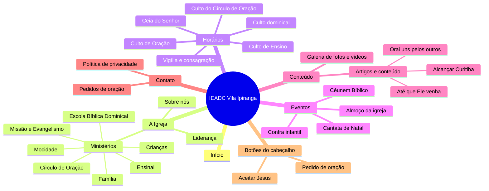

# Mapa do site: todas as páginas e como chegar nelas

Atualizado em 18/11/2026 (fase 7). Fonte: o menu do cabeçalho (`Aparência > Menus`, local `primary`), o mapa do rodapé (gerado do mesmo menu) e as páginas publicadas. A auditoria foi feita no site local: as **25 páginas** têm link no cabeçalho e no rodapé. O que não tem link direto no cabeçalho nem no rodapé são os **itens dinâmicos** (os eventos cadastrados e os artigos), que se alcançam pelas páginas-mãe **Eventos** e **Conteúdo**.

## Mapa mental

## Como chegar em cada página

| Página | Endereço | Pelo cabeçalho | Pelo rodapé | Também por |
|---|---|---|---|---|
| Início | `/` | Início (e o logo) | Mapa do site | |
| Sobre nós | `/sobre-nos/` | A Igreja > Sobre nós (o título "A Igreja" leva à mesma página) | Mapa do site | Início |
| Liderança | `/lideranca/` | A Igreja > Liderança | Mapa do site | Sobre nós |
| Ministérios | `/ministerios/` | A Igreja > Ministérios | Mapa do site | Início |
| Cada ministério (7) | `/ministerios/<nome>/` | A Igreja > Ministérios > o ministério | Mapa do site | Cartões da página Ministérios e da Início |
| Horários e localização | `/horarios-e-localizacao/` | Horários | Mapa do site e "Cultos" | Início (botão "Ver horários") |
| Cada culto (6) | `/culto-de-oracao/`, `/culto-de-ensino/`, `/culto-do-circulo-de-oracao/`, `/culto-dominical/`, `/ceia-do-senhor/`, `/vigilia-e-consagracao/` | Horários > o culto | Mapa do site | Calendário e semana da Início e de Eventos |
| Eventos | `/eventos/` | Eventos | Mapa do site | Início (botão "Ver agenda") |
| Cada evento cadastrado | `/eventos/evento/<nome>/` | (não tem) | (não tem) | Cartões e calendário de Eventos, Início |
| Artigos e conteúdo | `/artigos/` | Conteúdo | Mapa do site | Início (botão "Ver conteúdos") |
| Cada artigo | `/<nome-do-artigo>/` | (não tem) | (não tem) | Página Artigos, Início e artigos vizinhos |
| Galeria | `/galeria/` | Conteúdo > Galeria de fotos e vídeos | Mapa do site | Início |
| Aceitar Jesus | `/aceitar-jesus/` | Botão final "Aceitar Jesus" (destaque) | Mapa do site | Início |
| Contato | `/contato/` | Contato | Mapa do site e "Contato" | Botões "Fale conosco" |
| Pedidos de oração | `/pedidos-de-oracao/` | Botão "Pedido de oração" e Contato > Pedidos de oração | Mapa do site | |
| Política de privacidade | `/politica-de-privacidade/` | Contato > Política de privacidade | Mapa do site | Aviso de cookies |

## Pontos para o Felipe avaliar (duplicação e fluxo)

Nada falta no menu. Estes pontos são de **organização**, para decidir se vale simplificar:

1. **"A Igreja" e "Sobre nós" levam à mesma página.** O título "A Igreja" abre `/sobre-nos/` e o primeiro item do submenu também. Opção: deixar "A Igreja" só como rótulo do grupo, sem link.
2. **Círculo de Oração tem duas páginas:** o **culto** (`/culto-do-circulo-de-oracao/`) e o **ministério** (`/ministerios/circulo-de-oracao/`). Os dois falam das quintas-feiras. Opção: manter uma página com as duas coisas e redirecionar a outra.
3. **A programação semanal aparece em três lugares:** Horários, Eventos (calendário) e Início (semana). Opção: manter a página Horários como a oficial e deixar as outras como resumo com link.
4. **"Pedido de oração" aparece três vezes** (botão do cabeçalho, Contato > Pedidos de oração e rodapé). É proposital (é a ação mais importante), mas o submenu do Contato é o que menos ajuda.
5. **Política de privacidade** só aparece em Contato > Política e no rodapé; está bem para uma página legal.
6. **Página Artigos (`/artigos/`) e o grupo "Conteúdo":** o nome do menu é "Conteúdo" e a página se chama "Artigos e conteúdo". Opção: usar o mesmo nome nos dois.

Nenhuma dessas mudanças foi feita: dependem da sua decisão.

## Rotas técnicas (não aparecem para o visitante)

`/robots.txt`, `/llms.txt`, `/sitemap_index.xml`, `/favicon.ico`, `/evento-<id>.ics` (arquivo para o calendário de cada evento), `/wp-login.php` e `/wp-admin/` (só a equipe). Com o site **fechado**, visitantes recebem a página "em preparação" (503) em todas.
